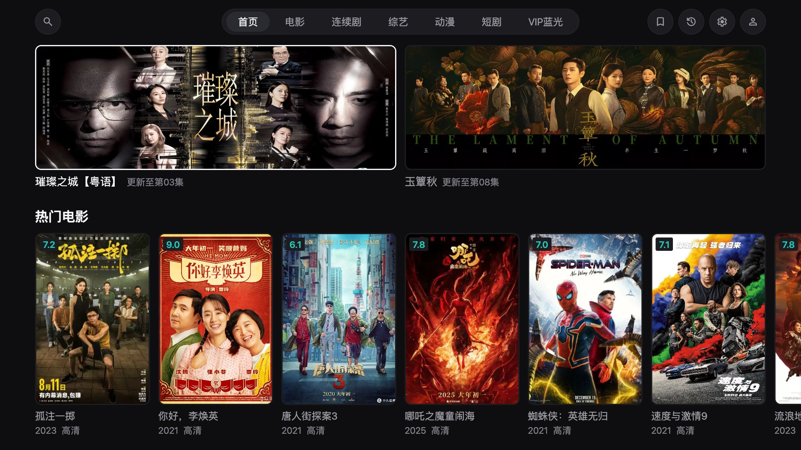
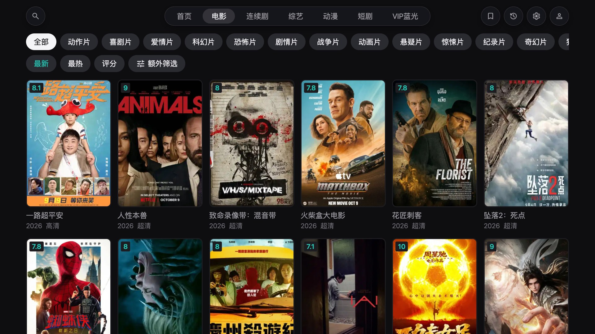
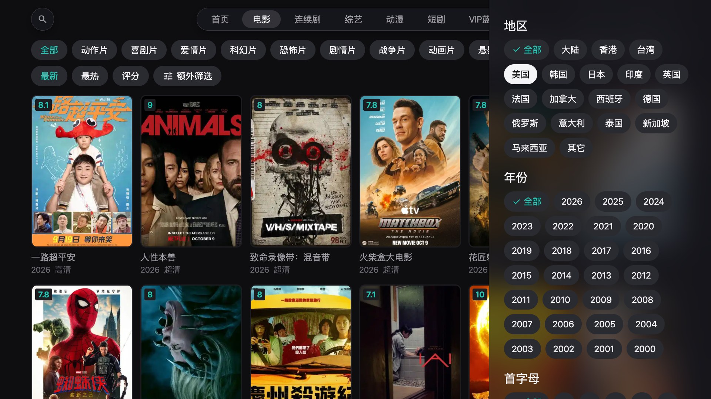
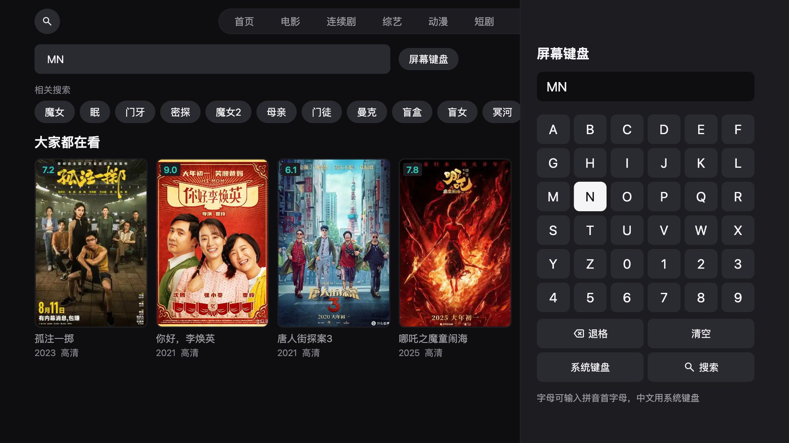
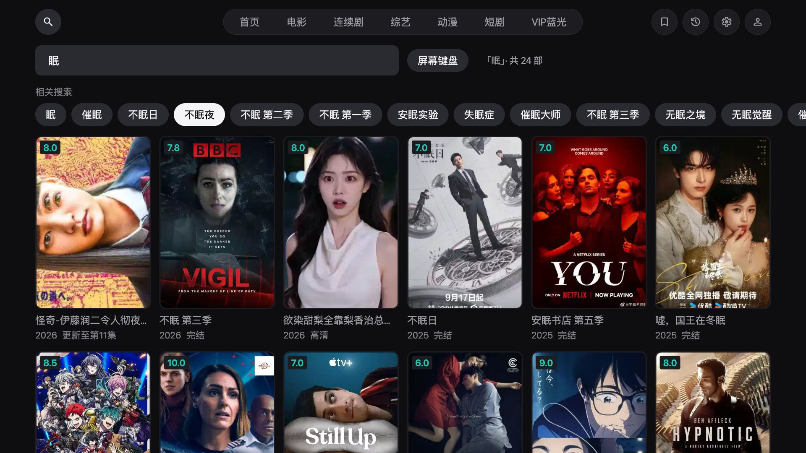
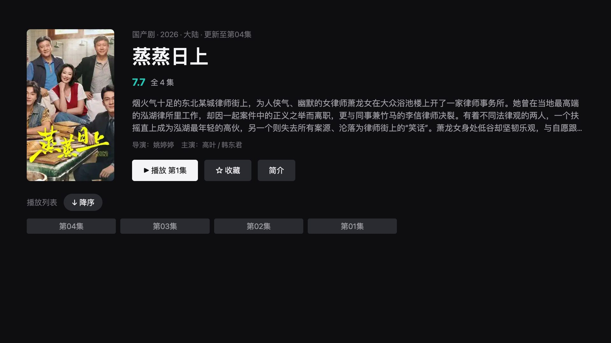
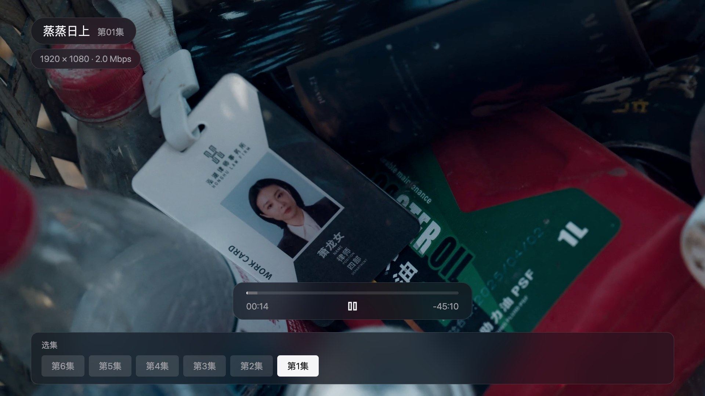
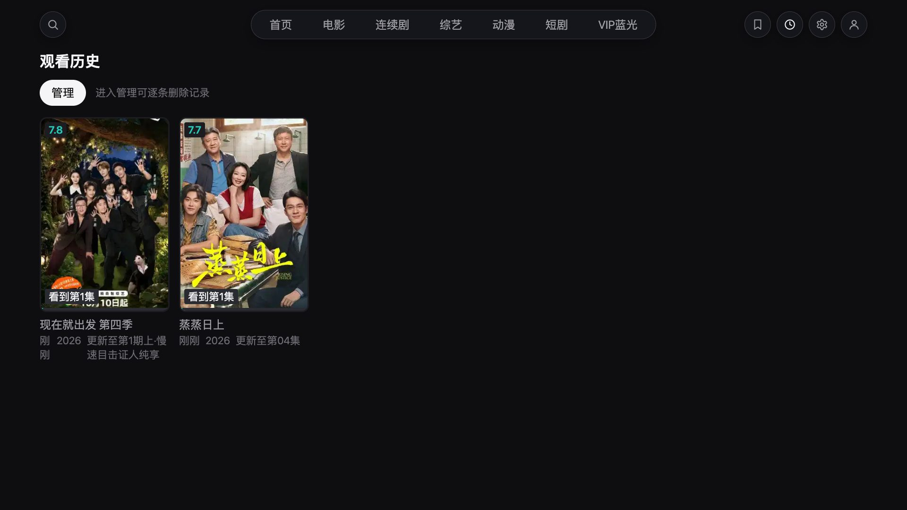
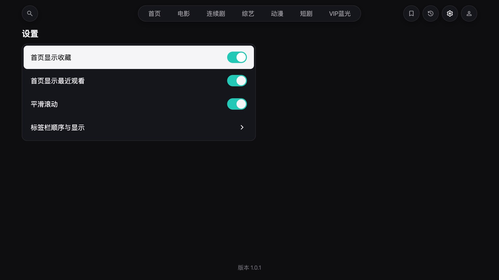
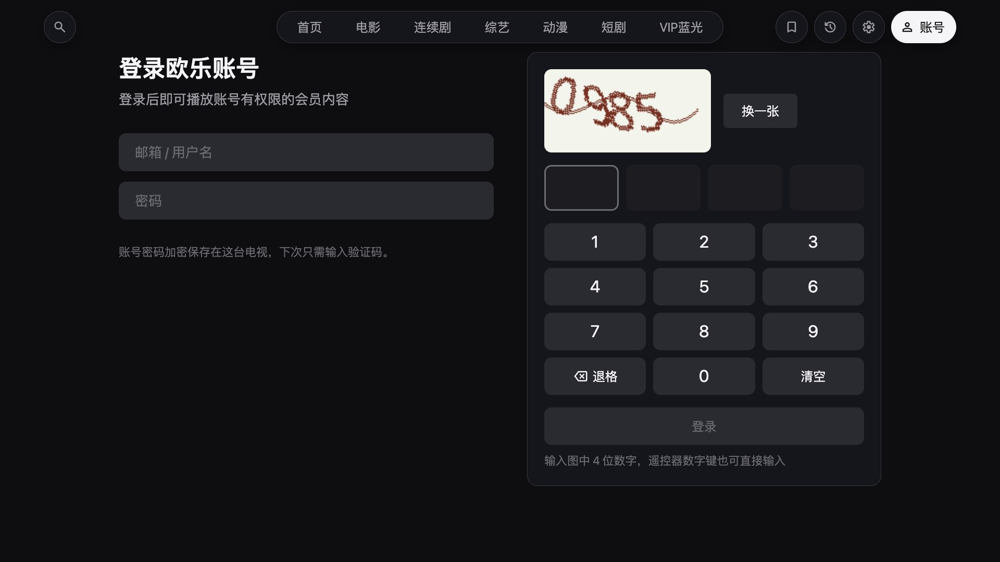

# 欧乐影视 · LG webOS TV

一个给 LG webOS 电视用的欧乐影视客户端：在客厅里只用遥控器方向键，就能找片、看剧、接着上次的进度往下看。界面按 1080p 大屏设计，焦点移动不触发重渲染，电视上操作也跟手。

这是个人项目，仅供学习交流，与欧乐影视官方没有任何关系。影片、海报和播放源都来自欧乐的公开接口，相关权利归原权利人所有。

**[下载最新版本](https://github.com/shichen35/olevod-webos/releases/latest)** · [安装教程](doc/install.md) · [遥控器操作](#遥控器操作)

| | |
| --- | --- |
| 设备 | LG webOS 24 及以上（2024 年及之后的机型），在 LG C4 上实测 |
| 操作 | 遥控器方向键、确认键、返回键；数字键可输入验证码；支持 Magic Remote 指针 |
| 安装 | 侧载 `.ipk`（开发者模式或已 root 的电视），不在 LG 应用商店上架 |
| 应用 ID | `com.olevod.app` |



## 功能

### 首页

最上面是精选推荐，接着是「继续观看」和「我的收藏」，下面按电影、综艺、连续剧、动漫各放一排热门。继续观看的卡片上直接标着看到第几集和进度条，按确认就能接着看。不想在首页看到收藏或最近观看，可以在设置里关掉。

### 分类与筛选

顶部标签栏有电影、连续剧、综艺、动漫、短剧和 VIP 蓝光。每个分类先按类型筛一层，再选最新、最热或评分排序；需要更细的条件时打开「额外筛选」，按地区、年份和片名首字母过滤。选项即点即生效，列表往下滚会自动加载。





### 搜索

用遥控器打汉字很慢，所以搜索页带了一个屏幕键盘，可以输入拼音首字母。比如按 `M` `N`，联想里就会出现「魔女」「门牙」这类片名，选中即搜。要输入中文时也可以切到系统键盘。搜索框为空时会显示热门搜索和最近搜过的词。





### 详情与选集

详情页有简介、导演和主演、评分和集数。主按钮会根据观看记录变成「播放第 1 集」「继续观看第 N 集」或「重新观看」；看完的剧出了新集，会直接跳到新的那一集。剧集列表可以切换升序或降序，并且每部剧单独记住；集数超过 60 集时按 50 集一组分段，打开时自动定位到上次看的那一组。



### 播放

- 打开就从上次的位置继续，屏幕上会提示从几分几秒开始。
- 左右键每次快进或快退 15 秒，按住不放会越跳越快，松手后才真正跳转，不会每按一下就卡一次。
- 剧集最后 30 秒弹出「即将播放」，按确认立即播放下一集；不管它，这一集结束后也会自动接上。
- 按下键呼出控制栏，再按下键打开选集条，播放中就能换集。
- 左上角显示当前片源的分辨率和码率。网络卡顿时会自动跳过缓冲空洞、重新加载，尽量不打断观看。



### 收藏、历史与设置

收藏在详情页一键添加。观看历史最多保留 40 部，每部都带进度；进入「管理」可以逐条删除，也可以一次清空。设置里可以调整首页显示哪些内容、开关平滑滚动，还能自定义顶部标签栏的顺序和显隐。





### 账号与 VIP

不登录也能看普通内容。VIP 剧集需要登录有 VIP 权限的欧乐账号：在「账号」页输入账号密码和 4 位图片验证码，验证码可以用屏幕数字键盘，也可以直接按遥控器上的数字键。登录成功后账号密码会加密保存在这台电视上，下次只需要输验证码。没登录时点开 VIP 剧集，会直接弹出登录页，登录后回到原处继续。



## 遥控器操作

| 位置 | 按键 | 作用 |
| --- | --- | --- |
| 任意页面 | 方向键 / 确认 | 移动焦点 / 打开或执行 |
| 内容区 | 返回 | 回到顶部标签栏 |
| 顶部标签栏 | 左右 | 切换标签，页面随之切换 |
| 顶部标签栏 | 确认 | 立即切换；在首页和分类页上会重新加载内容 |
| 顶部标签栏 | 返回 | 退出应用（系统会先确认） |
| 详情页、弹窗、筛选面板 | 返回 | 关闭并回到上一处，焦点保持原位 |
| 账号页验证码 | 数字键 0–9 | 直接输入验证码 |
| 播放中（控制栏隐藏） | 确认 | 暂停或继续 |
| 播放中（控制栏隐藏） | 左 / 右 | 后退或前进 15 秒，按住加速 |
| 播放中（控制栏隐藏） | 下 / 上 | 呼出控制栏 / 显示按键提示 |
| 播放中（控制栏显示） | 上 / 下 | 收起控制栏 / 打开选集条 |
| 选集条 | 左右 / 确认 | 选择剧集 / 切换到该集 |
| 选集条 | 上 / 返回 | 收起选集条 |
| 「即将播放」卡片 | 确认 / 上 | 立即播放下一集 / 关闭卡片 |
| 播放中 | 返回 | 收起控制栏；没有控制栏时退出播放 |
| 播放中 | 播放、暂停、快进、快退、停止 | 媒体键可用，快进、快退每次 30 秒 |

## 安装

1. 从 [Releases](https://github.com/shichen35/olevod-webos/releases/latest) 下载 `.ipk`。
2. 打开电视的开发者模式，用 `ares-install` 或 [webOS Dev Manager](https://github.com/webosbrew/dev-manager-desktop) 安装。
3. 开发者模式约 50 小时过期，过期后侧载的应用会被删除，记得定期续期。已 root 的电视没有这个限制。

完整步骤、升级和卸载见 [安装教程](doc/install.md)。

## 已知限制

- 画质全自动，最高到 1080p 左右，没有手动切换清晰度，也没有 4K/HDR。
- 没有倍速、字幕和多音轨。
- 没有直播、弹幕和投屏。
- 收藏和观看历史只保存在本机，不和欧乐网站的账号同步；卸载应用会一并清除。
- 内容全部来自欧乐接口，接口调整、片源下架或网络问题都会影响使用。

## 开发

```bash
cd app
npm install
npm run dev      # 浏览器里开发，方向键、Enter、Esc 代替遥控器
cd ..
bash build.sh    # 打包 .ipk 到 out/
```

| 文档 | 内容 |
| --- | --- |
| [安装教程](doc/install.md) | 开发者模式、命令行安装、Dev Manager、升级与卸载 |
| [开发与构建](doc/development.md) | 本地开发、打包、发版流程 |
| [架构概览](doc/architecture.md) | 目录结构、双通道数据层、焦点模型、术语 |
| [焦点引擎](doc/dev/focus-engine.md) | 方向键导航如何做到零重渲染 |
| [数据通道](doc/dev/data-channel.md) | Luna 服务、本地 HLS 代理与传输选择 |
| [签名与解密](doc/dev/sign-and-crypto.md) | 请求签名、载荷解密、会话 token |
| [本地存储](doc/dev/storage.md) | 收藏、历史、设置与加密凭据 |
| [播放器](doc/dev/player.md) | 续播、跳转、自动下一集、卡顿恢复 |
| [打包与发布](doc/dev/packaging.md) | build.sh、appinfo.json、Release 工作流、真机调试 |

## 许可证

源码采用 [MIT License](LICENSE)。界面图标来自 Google 的 Material Symbols，按 Apache License 2.0 使用，见 [THIRD_PARTY_NOTICES.md](THIRD_PARTY_NOTICES.md)。欧乐影视的名称以及通过接口获取的影片、海报等内容不属于本项目，也不在该许可证范围内。
