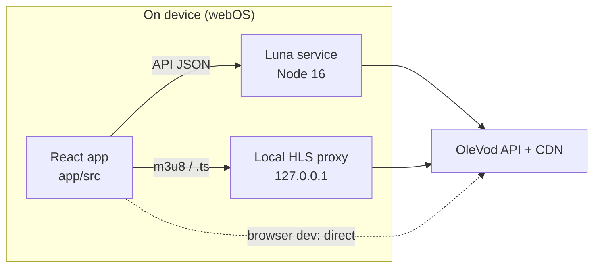

# OleVod webOS TV

A video client for LG webOS televisions, serving the OleVod service. The layout
is a top tab bar above a full-width content area — a 10-foot UI meant to be read
from across the room and driven entirely by the remote's directional pad
(D-pad). Performance comes first: moving the focus never re-renders React, and
there is no animation and no translucency anywhere in the interface.

| | |
| --- | --- |
| **Target device** | LG webOS 24 — Chromium 108 on the frontend, Node.js 16 on the service side — at 1080p with a D-pad remote. The reference set is the LG C4. |
| **Stack** | Vite with React 19.2 for the frontend, a Node.js 16 Luna background service carrying both the API and media channels, and hls.js for playback. |
| **Feature scope** | Home shelves, the Movies / TV Series / Variety / Anime / VIP Blu-ray sections, search, the detail page, HLS playback, OleVod account sign-in with a captcha (which unlocks VIP playback), and a Library holding favorites, history, and settings. |

Several things are deliberately absent: there is no live streaming, no screen
casting, no danmaku (scrolling comment overlay), and no cloud sync — favorites
and watch history stay on the TV even when signed in.

## Directory Structure

Four top-level entries carry the whole project:

```
app/        frontend (Vite + React 19.2)
  src/{config,api,hooks,store,components,pages,player,styles}
  webos-meta/   appinfo.json + icons, consumed at packaging time
service/    Luna background service (Node 16, CommonJS): API fetch + local HLS proxy
doc/        per-task development docs (T01-T25)
build.sh    builds the app, then packages it into an .ipk
```

## Development

Everyday work happens inside `app/`:

```bash
cd app
npm install
npm run dev        # dev server, browser connects directly to the API (both API and CDN allow CORS, no proxy needed)
npm run build      # production build to app/dist (target chrome108, base './')
npm run preview    # preview the build output locally
```

There are no automated tests. Verification means two things: `npm run build`
has to pass, and someone has to walk the app manually with remote-control input
in the browser, the preview server, or the webOS Simulator.

In the browser, the keyboard stands in for the remote — arrow keys navigate,
Enter selects, and Esc goes back. On a real device that back action arrives as
webOS keyCode 461.

## Build and Package (webOS)

Packaging needs LG's official command-line tools, which provide the `ares-*`
commands:

```bash
npm install -g @webos-tools/cli     # ares-* commands; verify with ares -V
bash build.sh                       # build + package .ipk into out/
```

[doc/T23](doc/T23-packaging-deploy.md) covers the packaging details.

## Architecture Highlights

**Dual-channel data layer.** API responses and media travel over separate
paths on the device. JSON goes through the Luna service; media segments
(`m3u8` and `.ts`) go through a local proxy on `127.0.0.1` that the service
opens. In the browser dev environment neither hop exists and everything
connects directly:



Which channel a request takes is decided in one place, `app/src/api/luna.js`,
so the business layer never has to know where it is running. Every fetch then
funnels through `apiGet` or `apiPost` in `app/src/api/http.js`, which signs the
request, sends it over the selected transport, validates what comes back, and
decrypts the payload.

**Config-driven navigation.** The section tree lives in
`app/src/config/taxonomy.js`. Adding a section is a single-file edit — the tab
bar, the routing, and the section pages all read from that config and pick the
change up on their own.

**Zero re-render focus.** `app/src/hooks/useFocus.js` keeps focus movement out
of React entirely: it toggles a DOM class and calls `scrollIntoView`, nothing
more.

**Request signing.** Every GET carries a `?_vv=<signature>` query parameter,
generated locally from a timestamp in `app/src/api/sign.js`. POSTs (captcha,
login, user info) go without it. When signed in, every request also carries the
session token, split into the `_he` / `_pl` / `_si` query parameters.

**Account session.** Signing in happens on a full-screen account page reached
from 我的 → 设置 → 欧乐账号: a captcha image, an on-screen digit keypad, and the
remembered username and password filled in. Both the remembered login and the
session token are encrypted at rest (`app/src/store/vault.js`): an AES-GCM key
generated as non-extractable lives in IndexedDB, and localStorage only ever
holds ciphertext. This keeps plaintext out of storage dumps and logs, but it is
not hardware-backed — code running inside the app's origin can still decrypt.
A token-bearing request answered with an auth-expired code signs the session
out silently; the detail page then offers sign-in when a VIP episode is played.

For the design rationale and acceptance criteria behind each subsystem, see the
per-task docs in [doc/](doc/) (T01-T25).

## Glossary

| Term | Meaning |
| --- | --- |
| **10-foot UI** | An interface sized and spaced to stay legible from couch distance rather than desk distance. |
| **D-pad** | The remote's directional pad — up / down / left / right plus a select key. The only input this app supports. |
| **Luna service** | A webOS background service (here, Node.js 16 CommonJS) that the frontend calls for work the browser sandbox can't do. |
| **HLS** | HTTP Live Streaming — the playback format, delivered as an `m3u8` playlist pointing at `.ts` segments. |
| **`.ipk`** | The installable package format for webOS apps, produced by `build.sh` into `out/`. |
| **`ares-*`** | LG's official webOS command-line tools, installed via `@webos-tools/cli`. |
| **danmaku** | Viewer comments that scroll across the video as it plays. Out of scope here. |
| **`_vv`** | The signature query parameter attached to every API GET. |
| **Session token** | The three-part value returned by login, sent on every request as `_he` / `_pl` / `_si` while signed in. |
| **VIP episode** | An episode flagged `vip`; without a session holding VIP rights the detail API returns it with an empty URL. |
