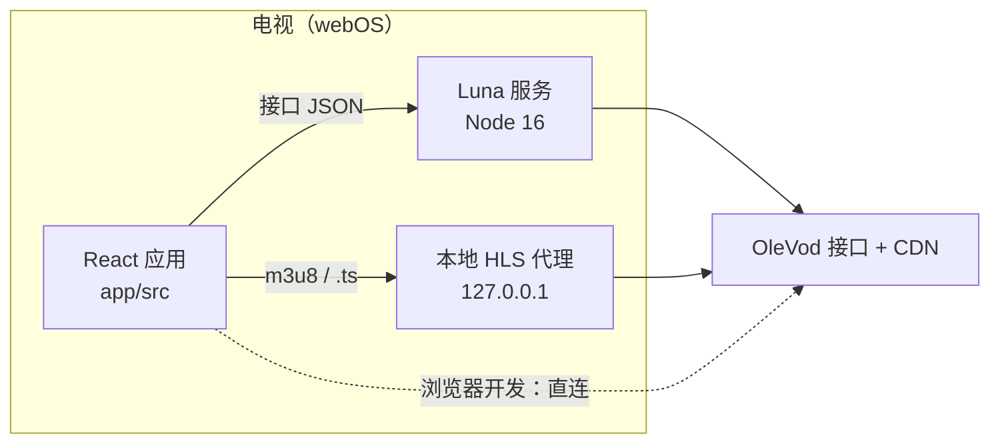

# 架构概览

应用分两部分，打进同一个 `.ipk`：

- `app/`：前端，Vite + React 19，构建目标 Chromium 108（webOS 24）。
- `service/com.olevod.app.service/`：Luna 后台服务，Node.js 16、CommonJS，负责替前端访问接口，并在本机开一个 HLS 代理。

界面是顶部标签栏加全宽内容区，按 1920×1080 布局，只靠遥控器方向键操作。性能优先：焦点移动不触发 React 重渲染，长列表按需加载，播放器代码懒加载。

## 目录

```
app/
  src/
    config/      标签栏与分类配置（taxonomy.js、nav.js）
    api/         签名、加解密、传输选择、业务接口
    hooks/       焦点引擎 useFocus、本地存储 useStore
    store/       收藏、历史、设置、搜索记录、凭据保险箱
    components/  卡片、标签栏、筛选面板、对话框、屏幕键盘
    pages/       首页、分类、搜索、详情、收藏、历史、设置、账号
    player/      播放器
    styles/
  webos-meta/    appinfo.json 和图标，打包时合并进构建产物
service/com.olevod.app.service/
                 Luna 服务：接口转发 + 本地 HLS 代理
build.sh         构建并打包 .ipk 和 manifest
doc/             文档
```

## 双通道数据层

在电视上，接口和媒体走两条路：JSON 接口经 Luna 服务转发；`m3u8` 和 `.ts` 分片走服务在 `127.0.0.1` 上开的本地代理。浏览器开发时这两跳都不存在，前端直接请求。



走哪条路只在 `app/src/api/luna.js` 里判断一次，业务层不需要知道自己运行在哪。所有请求都经过 `app/src/api/http.js` 的 `apiGet` / `apiPost`：签名、发送、校验返回码、解密载荷。细节见 [数据通道](dev/data-channel.md) 和 [签名与解密](dev/sign-and-crypto.md)。

## 配置驱动的导航

分类树写在 `app/src/config/taxonomy.js`。标签栏、路由和分类页都从这里读，新增一个分类只改这一个文件。用户还可以在设置里调整标签的顺序和显隐。

## 零重渲染焦点

`app/src/hooks/useFocus.js` 让焦点移动完全绕开 React：切换一个 DOM class，再调 `scrollIntoView`。返回键、文本框按键透传、Magic Remote 指针也都在这里统一处理。见 [焦点引擎](dev/focus-engine.md)。

## 账号会话

登录在「账号」标签页完成；播放 VIP 剧集时也会以浮层形式弹出同一个页面：验证码图片、屏幕数字键盘，记住的账号密码自动填好。记住的凭据和会话 token 都加密保存：AES-GCM 密钥以不可导出的形式存在 IndexedDB，localStorage 里只有密文。它能防止明文出现在存储导出或日志里，但不是硬件级保护，应用自身来源里运行的代码仍然能解密。带 token 的请求如果返回登录过期，会静默退出登录。见 [本地存储](dev/storage.md)。

## 播放器

hls.js（light 版）播放 HLS，自动码率，上限低于 1440p。支持断点续播、自动下一集、长按加速快进、卡顿自动恢复。见 [播放器](dev/player.md)。

## 术语

| 术语 | 含义 |
| --- | --- |
| 10-foot UI | 按沙发距离设计的界面，字号和间距保证隔着客厅也看得清 |
| D-pad | 遥控器方向键加确认键，应用唯一支持的输入方式（Magic Remote 指针也可用） |
| Luna 服务 | webOS 的后台服务，前端调用它来做浏览器沙箱里做不到的事 |
| HLS | 播放格式，`m3u8` 播放列表加 `.ts` 分片 |
| `.ipk` | webOS 应用安装包，由 `build.sh` 输出到 `out/` |
| `ares-*` | LG 官方的 webOS 命令行工具，来自 `app/` 的开发依赖 `@webos-tools/cli` |
| `_vv` | 每个 GET 请求都要带的签名参数 |
| 会话 token | 登录返回的三段值，登录期间作为 `_he` / `_pl` / `_si` 随请求发送 |
| VIP 剧集 | 标记为 `vip` 的剧集；没有 VIP 权限的会话请求详情时，它的播放地址为空 |
