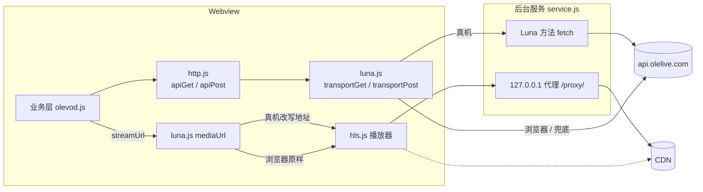

# 数据通道：API 走 Luna，媒体走本地代理

应用对外的网络请求分两类，走两条路：

- API JSON（列表、详情、登录等）：真机上经 Luna 总线交给后台服务去请求，浏览器里直接 `fetch`。
- 媒体（m3u8 和 .ts 分片）：真机上改写成 `http://127.0.0.1:{port}/proxy/...`，由同一个服务开的本地 HTTP 代理转发；浏览器里原样加载。

业务层（`app/src/api/olevod.js` 及以上）完全不知道自己跑在哪种环境里。环境探测和传输选择只在 `app/src/api/luna.js` 一个文件里发生，整个 `app/src/` 里调用 `fetch(`、碰 `PalmSystem` / `PalmServiceBridge` 的也只有它。



## 为什么要分两条路

打包后的 webview 跑在 `file://` 源下，服务端注释里记录的结论是直接请求 api.olelive.com 走不通，所以 API 交给 Node 服务去取，取回来的是已解压的文本。媒体不能这么做：`<video>` 和 hls.js 只能按 URL 加载，没法从总线上收字节流，所以服务另开一个只监听 127.0.0.1 的 HTTP 代理，顺便补上 CDN 要的 Referer、透传 Range。

浏览器开发时不需要任何代理：API 网关和 CDN 都返回 `Access-Control-Allow-Origin: *`，POST 的预检也放行 `Content-Type`，所以 `npm run dev` 直接连线上。

## 环境判定：握手，而不是看全局变量

`window.PalmSystem` 存在只说明在 webOS webview 里，模拟器也有它，但模拟器里没有 Node 服务。所以 `isTV` 只决定"要不要试一下"，真正切到设备模式要看握手结果：

1. `app/src/main.jsx` 在首帧前 `await initTvEnv()`。
2. `initTvEnv()` 通过 `PalmServiceBridge` 调 `luna://com.olevod.app.service/ping`，超时 2 秒。
3. 回复里有 `ok` 和 `proxyPort` 才把 `serviceReady` 置真并记下端口；超时或报错一律留在直连模式，函数本身从不抛错。

端口必须从 ping 拿，不能写死：代理默认请求 7654，遇到 `EADDRINUSE` 会自增重试。因为握手发生在首帧之前，第一次生成的媒体地址就已经指向正确端口。

`lunaCall()` 直接用 webview 注入的 `PalmServiceBridge`，没有打包 webOSTV.js。总线调用没法真正中止，超时只是 reject 并调一下 `bridge.cancel()`，晚到的回复被丢弃。

## API 通道：apiGet / apiPost

`app/src/api/http.js` 是全应用唯一的取数入口，返回的是已经解包、解密好的 `data`。

GET 的流水线：

1. `buildUrl()` 拼上 `https://api.olelive.com`，每次现算 `_vv` 签名（`vvNow()`，见 `app/src/api/sign.js`）；已登录时再把三段式 token 拆成 `_he` / `_pl` / `_si` 三个查询参数。
2. `transportGet()`：设备模式走 Luna `fetch`，否则直连。
3. `unwrap()`：`JSON.parse`，校验 `code === 0`，不为 0 抛 `ApiError(msg, code)`。
4. `data` 若是非空字符串，尝试 `aesDecryptToJson()`；不是密文时返回 null，保留原值。

POST 少了第 1 步的 `_vv`，token 参数照带。目前只有验证码、登录、用户信息三个接口用 POST（`app/src/api/olevod.js`）。

### 超时与重试

| 环节 | 数值 | 位置 |
| --- | --- | --- |
| GET 单次尝试 | 3 秒，最多 3 次 | `http.js` `TIMEOUT_MS` / `RETRY_LIMIT` |
| POST | 8 秒，不重试 | `http.js` `POST_TIMEOUT_MS` |
| Luna `ping` | 2 秒 | `luna.js` `PING_TIMEOUT_MS` |
| Luna `fetch` | 10 秒 | `luna.js` `FETCH_TIMEOUT_MS` |
| 服务端到上游 | 10 秒 | `service.js` `UPSTREAM_TIMEOUT_MS` |

实际起作用的是 `http.js` 外层的 `withTimeout()`：它和传输调用赛跑，直连路径上会用 `AbortController` 真正取消请求，Luna 路径取消不了，就让它在后台跑完。Luna 的 10 秒只是兜底，正常情况下 GET 在 3 秒时就已经放弃这次尝试了。

几条规则背后的原因：

- 线上 API 偶尔会挂住几十秒，短超时加重试比干等强。
- 每次重试都重新签名，旧的 `_vv` 不能复用。
- 只重试网络、超时、解析错误。`ApiError` 是服务端给出的有效回答，立刻抛出。
- POST 有副作用：申请验证码会让上一张图作废，登录会消耗验证码。盲目重试会把一次慢的成功变成莫名其妙的失败，所以 POST 只发一次，超时时间给宽一点。

### 设备上的兜底

`transportGet()` 在 Luna 失败时（服务挂了、`returnValue` 不为真、上游非 2xx）会在同一次尝试里退回直连一次。`transportPost()` 故意没有这个兜底：Luna 超时不代表请求没到服务器，再发一次就是重复登录。

### 登录失效自动登出

`code` 为 12（未登录）或 13 / 14 / 16（会话过期）时，`unwrap()` 会调用 `setAuthExpiredHandler` 注册的回调，`app/src/store/session.js` 把它接到 `signOut()`。触发有两个前提：这次请求确实带了 token，并且这个 token 仍是当前 token。第二条是为了防止重新登录前发出的请求晚到，把新账号顶下线。token 本身也经 `setSessionTokenProvider` 注入，`http.js` 不持有任何账号状态。

## 媒体通道：本地代理

`PlayerPage.jsx` 拿到剧集的 m3u8 地址后调 `streamUrl()`，内部是 `mediaUrl()`：

```
https://{host}{path}?{query}  ->  http://127.0.0.1:{proxyPort}/proxy/{host}{path}?{query}
```

浏览器里、或握手失败时原样返回。代理（`service/com.olevod.app.service/service.js`）收到请求后：

- 从路径里取出 host，先过白名单，不在名单里直接 403；
- 以 HTTPS 请求上游，带 `Referer: https://www.olevod.com/`，透传客户端的 `Range`；
- 回写状态码和 `Content-Type`、`Content-Range`、`Content-Length`、`Accept-Ranges`，加上 `Access-Control-Allow-Origin: *`，然后 pipe 字节流。

m3u8 里的相对分片地址会相对代理地址解析，所以分片也自然走代理。

## 服务端的约束

- 不能变成开放代理。Luna `fetch` 只接受 hostname 恰好为 `api.olelive.com` 的 URL；媒体代理用 `isAllowedMediaHost()`，放行 `static.olelive.com` 以及 `olemovienews.com`、`yuntongclouds.com`、`oulehdtv.tv` 的子域名（后缀匹配，因为剧集分布在多个区域节点上）。遇到新的 CDN 域名播不了、日志里出现 `proxy 403`，就是这里要加。
- 出站头尽量少。网关只校验 `_vv`，不看 Referer / Origin，所以不伪造浏览器指纹。CDN 要 Referer，但一旦带了 Origin 就返回 403，所以代理永远不发 Origin。
- 媒体请求必须 `Accept-Encoding: identity`。代理原样转发字节，不会重写 `Content-Encoding`，如果上游给了 gzip，`Content-Range` / `Content-Length` 就对不上，播放器的 Range 请求会坏掉。API 通道则接受 gzip / deflate，在 `decompress()` 里解开；deflate 先试 zlib 包装格式，失败再试 raw。
- 复用 TLS 连接。`https.Agent` 开了 keepAlive，每个分片都重新握手在电视 CPU 上会表现为拖动后卡顿。
- 出错要断干净。上游报错时，响应头还没发就回 502，已经发了就直接销毁连接，半截分片比失败更难处理；客户端断开时也销毁上游请求，释放 socket。
- 保活。服务注册了一个 `keepAlive` activity，否则 webOS 会回收空闲的后台进程，下一次 Luna 调用就没人应答。
- 全局 `uncaughtException` 只记日志不退出，一个坏响应不能拖垮整个代理。

## 容易踩的坑

- 图片目前不走代理。`imageUrl()` 直接返回 `static.olelive.com` 的地址，白名单里那一项是给代理预留的，前端并没有用到。
- Luna 路径的超时不会取消服务端请求。快速切页时，服务可能还在替已经放弃的请求取数据，这是预期行为。
- 服务的 `console.log` 进不了 journald，日志写在设备的 `/tmp/olevod-service.log`。
- 在开发机上可以 `node service/com.olevod.app.service/service.js` 单独跑：没有 `webos-service` 模块时只启动代理，适合用 curl 直接验证白名单、Referer 和 Range 透传。
- 服务和前端一起由 `build.sh` 打进同一个 ipk，服务的 `package.json` 版本号也由它同步。
