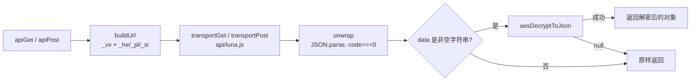

# 请求签名与载荷解密

OleVod 的 API 网关（`api.olelive.com`）对客户端有三类约束：GET 必须带 `_vv` 时间戳签名，否则直接 401；部分列表接口把 `data` 字段做了 AES 加密；登录后的请求要把会话 token 拆成三段放进查询参数。这三件事都在前端完成，集中在两个文件里：

- `app/src/api/sign.js`：纯算法，`vv()` / `vvNow()`、`aesDecryptToJson()`，以及内置的 `md5()`。不碰网络，不做环境判断。
- `app/src/api/http.js`：全应用唯一的请求入口 `apiGet()` / `apiPost()`，负责拼 URL、超时重试、校验 `code`、透明解密。

业务层（`app/src/api/olevod.js`）只调 `apiGet(path)` / `apiPost(path, body)`，拿到的是已经解包、已经解密的 `data`，不需要知道签名和加密的存在。

## 一次请求经过什么

传输层（`app/src/api/luna.js`）拿到的是已经签好名的完整 URL。真机上它交给 Luna 服务 `service/com.olevod.app.service/service.js` 的 `fetch` 方法去请求，浏览器里直接 `fetch`。服务端只做转发和解压，不参与签名，也刻意不带 Referer/Origin 之类的浏览器指纹：网关只认 `_vv`。

## 哪些请求带什么

| 请求 | `_vv` | `_he` / `_pl` / `_si` | 超时 | 重试 |
| --- | --- | --- | --- | --- |
| GET（`/v1/pub/...` 列表、详情、搜索、横幅） | 每次都带 | 登录时带 | 3s | 最多 3 次，每次重新签名 |
| POST（`/pub/captcha`、`/pub/user/login`、`/pub/user/info`） | 不带 | 登录时带 | 8s | 不重试 |

POST 接口没有 `v1` 前缀，也不需要 `_vv`。不重试是有意为之：每次 POST 都有副作用，取验证码会让上一张图作废，登录会消耗掉验证码，盲目重试只会把一次慢成功变成一次莫名其妙的失败。同理，`transportPost` 在真机上 Luna 超时后也不会退回直连再发一次（见 `luna.js` 注释）。

## `_vv` 签名

`vv(ts)` 的输入是 Unix 秒级时间戳，构造分两步：

1. 位转置。时间戳的每个数字字符取 ASCII 码的二进制（`'0'`..`'9'` 是 `110000`..`111001`，固定 6 位，前两位恒为 `11`），去掉前两位，剩下 4 位分别追加到四列。每列得到一个长度等于数字个数的二进制串，转成十六进制，不足 3 位左补 0。10 位时间戳每列 10 bit，最多 3 个 hex 字符，所以四段都正好 3 位。
2. 交织。把 `md5(时间戳)` 切成 `[0:3] [6:11] [14:19] [22:27] [30:]` 五段，与上面四段交替拼接。

换个角度看：结果就是 32 位的 md5，只是把 `[3:6]`、`[11:14]`、`[19:22]`、`[27:30]` 这四个 3 字符窗口换成了转置后的时间戳。所以 `_vv` 长度和 md5 一样是 32，服务端可以从中还原时间戳再核对 md5。

几点约定：

- `vvNow()` 每次现算，绝不缓存。`apiGet` 的重试循环里每次都重新调用 `buildUrl`，过期的签名不能复用。
- MD5 是 `sign.js` 里手写的纯 JS 实现。目标设备的 Chromium 108 WebCrypto 不支持 MD5，又不想为此引入依赖。`md5` 也被导出，方便在控制台调试。
- 签名依赖设备时钟。电视时间不准时，所有 GET 都会 401。排查鉴权问题先看时间。

## AES 载荷解密

部分列表接口返回的 `data` 不是对象而是一段 base64 字符串。`aesDecryptToJson(cipherB64)` 的参数：

- 算法 AES-128-CBC，PKCS7 填充（WebCrypto 的 `AES-CBC` 自动去填充）；
- key 取 `md5("YYYY-MM-DD")` 的 `[8:24]`，16 个 ASCII 字符直接当 16 字节用；日期是设备本地日期；
- IV 与 key 相同。

流程是 base64 解码、`crypto.subtle.decrypt`、`TextDecoder`、`JSON.parse`。任何一步失败都返回 `null`，不抛异常。

`http.js` 的 `unwrap()` 利用这个约定做"透明解密"：只要 `data` 是非空字符串就试着解一次，返回 `null` 说明它本来就不是密文（有的接口在同一字段里直接返回明文），保留原值。这样业务层不用维护"哪些接口加密"的清单。

## 会话 token 与 `_he` / `_pl` / `_si`

`POST /pub/user/login` 返回的 `token` 是一个用 `.` 分成三段的字符串。`buildUrl()` 把它 `split('.')` 后，三段分别 URL 编码放进 `_he`、`_pl`、`_si`。GET 和 POST 都带。

token 的来源和去向：

- `http.js` 本身不持有账号状态，只通过 `setSessionTokenProvider()` 注入的函数读取当前 token。接线在 `app/src/store/session.js` 的 `initSession()`，它在首帧之前从加密存储（`app/src/store/vault.js`）里解出上次的会话。
- 登录、登出、过期都会改变 `sessionStore`。`app/src/api/feeds.js` 订阅 token 变化并清空 `pageCache`，`App.jsx` 随后重新预取，保证缓存里不残留另一个身份下的响应。
- 响应 `code` 为 12（未登录）或 13/14/16（会话过期）时，`unwrap()` 调用 `setAuthExpiredHandler()` 注入的回调，也就是 `signOut()`。前提有两个：这次请求确实带了 token，而且带的 token 仍然是当前 token。后一条防止重新登录前发出的慢请求回来后把新账号踢下线。

## 错误分类

`unwrap()` 遇到 `code !== 0` 抛 `ApiError`（带 `code` 字段）。这是网关给出的有效业务拒绝，`apiGet` 不会重试；只有网络错误、超时、JSON 解析失败才会换新签名重试。调用方据此区分"服务器明确说不行"和"没连上"。

## 容易踩的坑

- 时钟不准：`_vv` 失效导致 401，同时 AES key 用的日期也会错，加密接口解出 `null` 后 `data` 保持字符串，下游取 `data.list` 得到空列表。表现是"有的页面 401、有的页面空白"，根源相同。
- 跨午夜：key 每天变。请求在 23:59:59 发出、响应在次日到达，或者设备时区与服务端约定的日期不一致，都会解密失败，现象同上，刷新一次即可恢复。
- token 不是三段时，`buildUrl()` 静默不带会话参数，请求按未登录处理，不报错。改动登录接口解析时留意这一点。
- 新增 GET 接口不需要额外处理签名和解密，走 `apiGet` 即可；新增 POST 接口要想清楚是否幂等，`apiPost` 不会替你重试。
- 浏览器开发模式下请求直连网关（网关返回 `Access-Control-Allow-Origin: *`），在 DevTools 的 Network 面板里能直接看到带 `_vv` 的完整 URL 和原始响应，调试签名或密文最方便。
