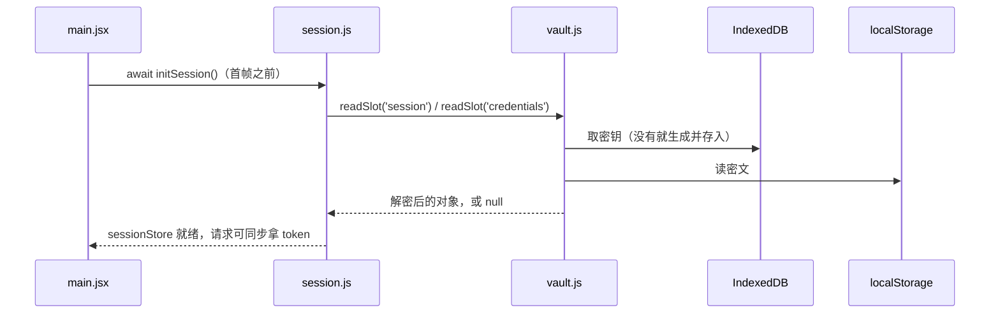

# 本地存储

应用的所有用户数据都只存在这台电视上：设置、收藏、观看记录、搜索记录、选集排序，以及加密后的账号和会话。没有云端同步，换一台电视或清除应用数据，这些就都没了。

存储代码集中在 `app/src/store/` 和 `app/src/hooks/useStore.js`。

## 持久化的数据一览

| localStorage 键 | 文件 | 内容 | 上限 |
| --- | --- | --- | --- |
| `olevod:settings` | `store/settings.js` | 用户偏好对象 | — |
| `olevod:favorites` | `store/favorites.js` | 收藏列表，最新收藏在前 | 不设上限 |
| `olevod:history` | `store/history.js` | 观看记录，带续播进度 | 40 条 |
| `olevod:searchHistory` | `store/searchHistory.js` | 最近搜索词 | 20 条 |
| `olevod:epOrder` | `store/episodeOrder.js` | 改成正序的剧集 `{ [vodId]: true }` | 不需要 |
| `olevod:vault:session` | `store/vault.js` | 会话 token 的密文 | — |
| `olevod:vault:credentials` | `store/vault.js` | 记住的账号密码的密文 | — |

另外 IndexedDB 里有一个库 `olevod-vault`（object store `keys`，键 `v1`），只放保险箱的加密密钥。

## createStore 和 useStoreValue

前五项都通过 `createStore(key, defaultValue)` 创建（`app/src/hooks/useStore.js`），返回 `{ get, set, subscribe }`：

- 模块加载时从 localStorage 读一次，之后读写都走内存快照。
- `set` 接受新值或 updater 函数。写入时替换快照引用（不原地修改），再写 localStorage，最后通知订阅者。返回同一个引用就视为没变，不写也不通知，所以 updater 里「无事可做」时要原样 `return prev`。
- 读失败（JSON 损坏、存储不可用）回退到默认值；写失败（超配额、存储被禁用）静默吞掉，本次运行继续用内存里的值。

组件用 `useStoreValue(store, selector)` 订阅，底层是 React 的 `useSyncExternalStore`。快照引用只在写入时变化，`getSnapshot` 在两次写入之间返回同一个值，这是避免无限重渲染的前提。由此有一条硬规则：selector 只能「挑」不能「算」，写 `s => s.items` 可以，写 `s => s.items.filter(...)` 每次都返回新数组，会让 React 陷入死循环。需要派生的值在组件里用 `useMemo` 算。

非组件代码直接调 `store.get()`，比如 `app/src/hooks/useFocus.js` 在滚动时读 `smoothScroll` 设置。

`createMemoryStore(initialValue)` 是同一套接口的纯内存版本，给会话这类走保险箱持久化的状态用。

## 各个 store

**settings**：默认值在 `DEFAULTS` 里，目前有首页两个货架开关（`homeShowFavorites`、`homeShowRecent`）、底栏顺序 `tabOrder`、隐藏的标签 `hiddenTabs`、平滑滚动 `smoothScroll`。老版本存下的快照可能缺新加的键，所以读设置一律走 `getSetting(snapshot, key)`，缺了就用默认值。新增设置只需在 `DEFAULTS` 里加一项。

**favorites**：`toggle(item)` 不存在就插到最前，存在就移除。条目是卡片要用的那几个字段，不是完整详情。

**history**：最近观看，最新在前，超过 40 条从尾部截掉。每条可带 `watch: { lastEpisodeIndex, position, duration, finished }` 和 `updatedAt`。

- 只有播放器写历史（`app/src/player/PlayerPage.jsx`）：首帧开始播放时调 `recordHistory` 把剧排到最前并保留已有进度，播放过程中定时调 `recordProgress` 更新进度（位置取自 `timeupdate` 记下的值，不在收尾时现读 `currentTime`，电视上那时可能已经归零）。打开详情页不算看过。
- 离片尾不到 `FINISHED_TAIL_S` 秒就算看完。看完且有下一集，进度记为下一集的 position 0；看完且没有下一集，记 `finished: true` 而不是清掉，这样以后更新了新集还能接着看。
- 首页「继续观看」、历史页、详情页的「继续观看第 N 集」和播放器续播都读这一份数据。

**searchHistory**：`remember(word)` 去空格、去重后放到最前，保留 20 条。

**episodeOrder**：选集列表默认倒序（最新一集在前，就是接口返回的顺序）。只有用户切成正序的剧才记一条，切回倒序就删掉，所以这个表只会包含用户动过的剧，不需要上限。它只影响显示顺序，播放器算「下一集」用的始终是接口的原始顺序。

## 凭据保险箱

账号密码和会话 token 不能像上面那样明文存 JSON，所以单独有 `app/src/store/vault.js`，故意不复用 `createStore`。

- 密钥：WebCrypto 生成的 AES-GCM 256 位密钥，`extractable: false`，`CryptoKey` 对象直接存进 IndexedDB。脚本拿得到这个对象、能用它加解密，但导不出原始字节。
- 密文：每个槽位一个 localStorage 键，格式是 `base64(iv).base64(ciphertext)`，每次写入都换新的 12 字节 iv。
- 接口：`readSlot(name)` / `writeSlot(name, value)` / `clearSlot(name)`，槽位只有 `session` 和 `credentials` 两个。

上层是 `app/src/store/session.js`，它把会话和记住的账号放在两个 `createMemoryStore` 里，读写时经过保险箱：

几个行为值得注意：

- `initSession` 从不抛错，保险箱读不出来就当作未登录启动。
- 密文解不开（密钥丢了、数据损坏）时该槽位会被直接删掉，按「没有记录」处理；如果只是这次密钥加载失败，密文保留不动，下次再试。
- 登录成功才自动记住账号密码。退出登录只清会话，保留记住的账号；「忘记账号」只清账号，不动当前会话。
- 保险箱写失败不影响本次登录，只是下次启动要重新登录，或者在账号页提示「账号未能记住」。

### 能防什么，不能防什么

webOS 没有给第三方应用开放类似 AndroidKeyStore 的硬件密钥库，web 应用能用的只有 localStorage、IndexedDB 和 WebCrypto，Luna 服务那边同样没有。所以这里的加密只是静态存储层面的保护：

- 能防：翻看 localStorage 文件、导出或打印 store 快照、日志误打存储内容，看到的都是密文；拿到 `CryptoKey` 对象也带不走密钥。
- 防不住：能在本应用同源执行 JavaScript 的代码可以直接解密，也能直接读内存里的会话；拿到整个设备文件系统的人也能解密，因为 Chromium 会把密钥材料和密文写在同一台机器的磁盘上。

开发者模式的电视本来就能 SSH 进去，这个取舍可以接受。没把密钥放进 Luna 服务，是因为密钥和密文仍在同一台设备上，安全性没有实质提升，反而要维护浏览器和真机两条代码路径。将来如果 webOS 开放了硬件密钥库，只需替换 `vault.js` 里的密钥来源，密文格式和上层接口不用动。

## 不持久化的东西

- 筛选条件（`app/src/store/filters.js`）：每个分类当前的筛选只存在模块变量里。保存下来的筛选在底栏上看不出来，下次启动一进分类就停在上周选的地区、年代，看着像列表坏了或者是空的。所以每次启动都从默认筛选开始，同一次运行里各标签页保持挂载，自然记得各自的选择。
- 页面数据缓存（`app/src/store/pageCache.js`）：接口数据的内存缓存，让来回切标签不用转圈，刷新页面就清空。账号变化时 `App.jsx` 会 `pageCache.clear()`，旧账号下发起、晚于清空才返回的请求不会写回缓存（靠 `epoch` 计数判断）。

## 容易踩的坑

- 新加一个持久化 store，键名沿用 `olevod:` 前缀；如果数据会无限增长，要像 history 那样设上限，或者像 epOrder 那样只存例外。
- 改了已有 store 的数据结构，要考虑电视上已经存着的旧格式。settings 靠 `getSetting` 兜底；history 里没有 `updatedAt` 的旧条目就是不显示时间。
- 敏感数据一律走 `vault.js`，不要放进 `createStore`，那里存的是明文。
- 清除应用数据或删掉 IndexedDB 之后，保险箱里的密文就再也解不开，用户需要重新登录，这是预期行为。
